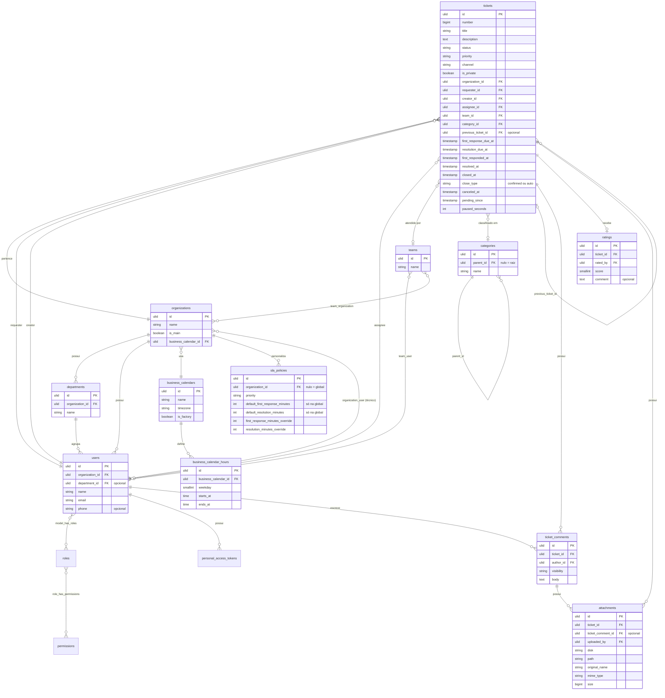

# Modelo de Dados Geral — Fase 1

> Mapa das entidades, relacionamentos e regras que valem para todas as specs.
> As colunas completas de cada tabela são definidas no `design.md` da spec correspondente e implementadas como migrations.
> Termos em [glossario.md](glossario.md). Última revisão: 2026-10-12.

## Regras gerais

| Regra | Detalhe | Princípios |
|---|---|---|
| Nomes | Inglês, `snake_case`, tabelas no plural | Convenção de idioma |
| Chave primária | **ULID** em todas as tabelas de domínio. Não sequencial, não adivinhável, ordenável por data | P6 |
| Número do chamado | Além do ULID, cada chamado tem um número sequencial amigável (ex.: `#1542`) para uso humano | P1 |
| Datas | Sempre em **UTC**. O fuso de cada calendário é usado apenas no cálculo de prazos | — |
| Remoção | **Soft delete** (`deleted_at`) nas entidades de domínio | P10 |
| Fábrica + override | Configurações guardam o valor de fábrica e um override opcional (nulo = usa o padrão). Restaurar o padrão = remover o override | P2 |
| Auditoria | Alterações registradas pelo pacote de activity log | P11 |

## Diagrama



## Entidades

### Estrutura e pessoas

| Tabela | Papel | Pontos-chave |
|---|---|---|
| `organizations` | Empresas atendidas | `is_main` marca a empresa de suporte (exatamente uma). Usa um calendário de horário útil |
| `departments` | Setores de uma organização | Pertence a uma organização |
| `teams` | Equipes técnicas | N:N com usuários (`team_user`) e com organizações atendidas (`team_organization`) |
| `users` | Contas | Organização obrigatória; departamento e telefone opcionais |
| `organization_user` | Técnico ↔ organização | Vínculo direto para a visibilidade "apenas organizações vinculadas" |

### Acesso (tabelas dos pacotes)

| Tabela | Pacote |
|---|---|
| `roles`, `permissions`, `model_has_roles`, `model_has_permissions`, `role_has_permissions` | spatie/laravel-permission |
| `personal_access_tokens` | Laravel Sanctum |
| `password_reset_tokens`, `sessions` | Laravel |

### Horário útil e SLA

| Tabela | Papel | Pontos-chave |
|---|---|---|
| `business_calendars` | Calendário de horário útil | Nome e fuso horário. Calendários de fábrica: "24×7" e "Comercial 5×2" |
| `business_calendar_hours` | Intervalos de atendimento | Dia da semana, início e fim. Vários intervalos por dia (ex.: pausa para almoço) |
| `sla_policies` | Prazos por prioridade | Linha **global** (organização nula) com fábrica + override; linhas **por organização** só com override |

Resolução do prazo aplicável a um chamado:

```
override da organização → override global → valor de fábrica
```

Os prazos são calculados contando apenas o horário útil do calendário da organização do chamado, descontando as pausas em Pendente.

### Catálogo

| Tabela | Papel | Pontos-chave |
|---|---|---|
| `categories` | Categorias em árvore | `parent_id` nulo = raiz. Profundidade livre. Subcategoria = categoria com pai |

### Chamados

| Tabela | Papel | Pontos-chave |
|---|---|---|
| `tickets` | Chamados | Ver detalhes abaixo |
| `ticket_comments` | Interações | `visibility`: `public` ou `internal` |
| `attachments` | Anexos | Pertencem a um chamado e, opcionalmente, a uma interação. Herdam a visibilidade (anexo de nota interna é interno) |
| `ratings` | Avaliação | No máximo uma por chamado. `score` de 1 a 5 |

Detalhes de `tickets`:
- **Chamado anterior** (`previous_ticket_id`): vincula um novo chamado a um chamado fechado, já que chamados fechados não são reabertos.
- **Organização gravada na abertura** (desnormalização consciente): filtro de visibilidade rápido (P4) e histórico preservado se o solicitante mudar de organização.
- **Momentos-chave no próprio chamado**: prazos (`*_due_at`), momentos reais (`first_responded_at`, `resolved_at`, `closed_at`, `canceled_at`), forma de fechamento (`close_type`: `confirmed` ou `auto`) e pausa (`pending_since`, `paused_seconds`). As métricas do dashboard saem de consultas diretas, sem varrer a auditoria (P4).

### Configuração e infraestrutura

| Tabela | Papel |
|---|---|
| `settings` | Configurações gerais (ex.: modo de visibilidade do técnico, dias úteis para fechamento automático), com fábrica + override |
| `activity_log` | Auditoria |
| `failed_jobs` | Jobs de fila que falharam |

## Anexos: armazenamento

- Gravados pelo sistema de arquivos do Laravel: **disco local por padrão** (P9), armazenamento compatível com S3 como opção (P8).
- Download sempre por endpoint autenticado, respeitando a visibilidade do chamado e da interação (P12).
- Limites de tamanho e tipos permitidos: definidos na spec de anexos.

## Fora da fase 1

| Item | Observação |
|---|---|
| Feriados nos calendários | Calendários consideram apenas dias da semana e horários |
| Ativos e equipamentos | Fase futura |
